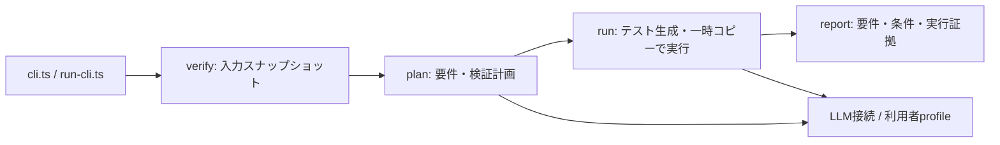
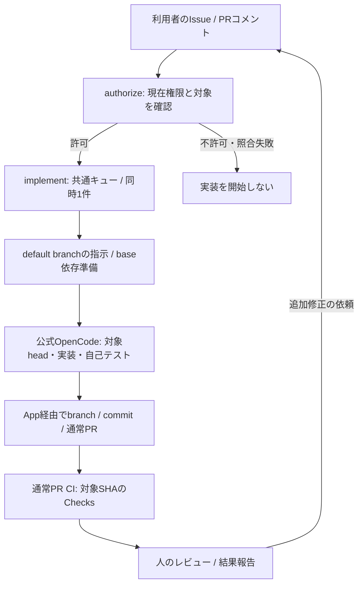

# アーキテクチャの地図

状態: 現行。基準revision: main `5145235`（2026-10-25）。個別の契約は [資料索引](docs/README.md) から参照してください。

## 製品CLI

| 配置                                              | 責務                                                           |
| ------------------------------------------------- | -------------------------------------------------------------- |
| `src/cli.ts`、`src/run-cli.ts`、`src/help.ts`     | エントリーポイント、振分け、入出力・ヘルプ                     |
| `src/verify/`                                     | 境界、base・差分・Issue読取、スナップショット                  |
| `src/plan/`                                       | profile・LLM接続、要件・出典、既存候補と不足シナリオ           |
| `src/run/`                                        | 入力一致確認、生成、一時コピー・依存準備、子プロセス実行、証拠 |
| `src/run/report.ts`、`schema.ts`、`render.ts`     | 状態集約とテキスト/JSONレポート                                |
| `tests/unit/`、`tests/integration/`、`tests/e2e/` | 個別処理、連携、ビルド済みCLI                                  |
| `fixtures/order-api/`                             | 入力用API・patchと、探索対象から分けた評価データ               |

入力読取・LLM通信・対象コード実行の境界を保ちます。テスト候補やLLMの解釈は実行証拠ではありません。元ワークツリー不変の契約は [隔離実行仕様](docs/isolated-execution.md) を参照してください。現行のNode.jsパーミッションを使うプロセス境界は、悪意あるコードの完全な封じ込めを保証しません。

製品の [自前実装を最小化する原則](docs/product-vision.md#自前実装を最小化する原則) に従い、#81では認証・通信・資格情報管理・モデル実行を公式CLIへ委譲する。Latchには入力の固定・送信許可・生成結果と出典の検証・隔離実行・証拠レポートを残す。Latch固有のデータ契約を検証する処理は、公式CLIのJSON出力だけでは代替できないため維持する。

これは移行先の責務であり、上図と配置表は現行実装を示す。旧API接続は未削除で、公式CLIの採用は [権限制限とログインの両立の検証](docs/official-cli.md) を終えてから判断する。開発ハーネスの認証・Secretsとは別の変更である。

## 開発ハーネス

製品CLIのprofile・隔離とは別の仕組みです。チャットで開発する場合はOpenCodeを現在の実行プラットフォームとGitHub接続に置き換えます。同じ権限・認証境界とは限りません。

| 工程       | 入力 → 出力・証拠                               | 権限と強制箇所                                                                                   | 失敗時                             |
| ---------- | ----------------------------------------------- | ------------------------------------------------------------------------------------------------ | ---------------------------------- |
| 認可       | コメント・actor・対象 → allowed                 | workflowで現在のwrite/maintain/admin、人・コマンド、開いた同repo PRを確認。LLMキー・checkoutなし | 不許可・照合失敗なら実装へ渡さない |
| 待機・準備 | allowed → job・base準備                         | implementだけ共通キュー、queue max。checkoutは資格情報非永続化、base installはignore-scripts     | Actionsの状態・ログを確認          |
| 実装       | 信頼した連携指示・依頼・head → 差分・自己テスト | 公式Actionへ委譲。APIキーとApp書込能力に触れ得る。head準備・非forceは指示                        | 失敗・未実行と安全な成果を報告     |
| PR         | commit → 通常PR・SHA                            | 公式App認証。マージ禁止等の指示は技術的剥奪と同義ではない                                        | 競合・App権限不足は引き継ぐ        |
| CI         | PRのcommit → Checks・ログ                       | tokenはcontents read。runner上でコード・設定・依存を実行                                         | 修正後のSHAで再確認                |
| レビュー   | 差分・証拠 → 判断                               | required checks・branch protectionの実設定は管理者領域。本変更では未確認                         | 自動承認・マージはしない           |

## 保証の読み方

認可・キュー・token設定はworkflow、期待動作はテスト、実行された事実は対象SHAのログが証拠です。GitHub側のキュー動作やApp実権限をモック合格だけで保証しません。

開発用runnerには、通信先の強制制限、実装コマンドからのキー分離、製品用sandboxと同等の隔離はありません。`permission: allow` は追加確認を省く設定で、安全境界を追加しません。headの依存スクリプトを実行する場合も同runnerの権限を踏まえて判断します。Issue・PR本文やコード内の指示で権限やSecretsを変更しません。

設定・停止方法は [運用手順](docs/opencode.md)、変更理由と比較は [ハーネス設計](docs/harness/design.md) を参照してください。
